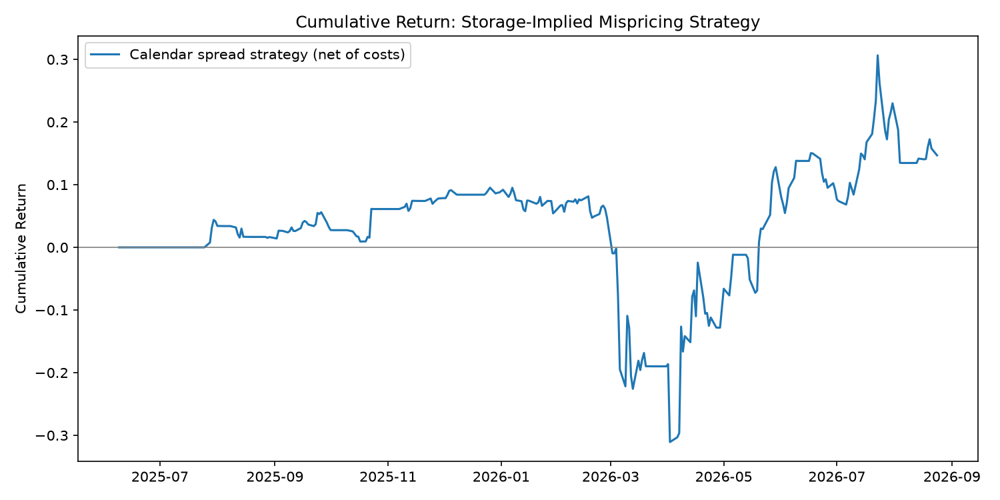

# WTI Crude Curve & Storage-Implied Convenience Yield

A cost-of-carry model for WTI crude oil futures that ties the shape of the
futures curve to physical inventory levels, and backtests a calendar-spread
strategy built on the deviation between the two.

## Why this project

Commodity futures curves aren't just a term structure of prices nut rather a
running readout of physical scarcity. Storage economics determine whether the curve trades in
contango or backwardation, in the same way that financing and expectations
determine the shape of a yield curve. This project treats the WTI curve the
way a rates desk treats a yield curve: strip out the carry, regress the
residual against the physical driver and trade the mean-reversion in that residual.

## Methodology

**1. Cost-of-carry model** (`src/models/cost_of_carry.py`)
For a storable commodity, no-arbitrage gives:

```
F(t,T) = S(t) · exp[(r + u − y)(T − t)]
```

where `y` is the convenience yield — the benefit of holding physical barrels
rather than a paper claim on future delivery. We invert this to back out
`y` from every point on the observed curve.

**2. Storage regression** (`src/models/storage_regression.py`)
Following Working (1949) and Fama & French (1987), convenience yield should
be a decreasing, convex function of inventory levels. We regress implied
convenience yield against EIA weekly crude storage data to estimate this
relationship empirically, and use it to define a "fair" convenience yield
given the current inventory level.

**3. Signal** (`src/strategy/signals.py`)
Mispricing = observed convenience yield − storage-implied fair convenience
yield. We z-score this residual on a rolling window and trade calendar
spreads (long near-month / short far-month, or the reverse) when the
mispricing crosses an entry threshold, exiting when it reverts.

**4. Backtest** (`src/backtest/engine.py`)
Event-driven-ish backtest with transaction costs charged on every position
change (2 bps default), lagged signal execution (no lookahead), and standard
performance metrics (Sharpe, max drawdown, hit rate).

## Known simplifications (stated up front, not hidden)

- Risk-free rate and storage cost rate are held constant rather than pulled
  from a live curve swap in SOFR and regional tankage rates for a more
  rigorous version.
- The shortest-dated contract is used as a spot proxy rather than an actual
  Cushing spot feed.
- No margin/leverage modeling — returns are on notional, not on margin.
- Yahoo Finance futures contract coverage can have significant gaps for
  far-dated or older/expired contract tickers; the pipeline skips dates it
  can't fill rather than interpolating silently. In practice this means the
  default date range is kept to roughly the last 12-15 months, where coverage
  is reliable enough to produce a meaningful sample size. Getting a longer,
  denser history would require a paid data source (CME DataMine, or Nasdaq
  Data Link's CHRIS/CME continuous contracts dataset) rather than Yahoo Finance.
- With a limited free-data sample, treat the regression R² and coefficients
  as a pipeline correctness check rather than a claim about the true
  storage/convenience-yield relationship -- the pipeline itself prints a
  warning if fewer than 30 observations survive the fetch + merge step.


## Project structure

```
src/
  data/           EIA API client, Yahoo Finance futures curve fetcher
  models/         cost-of-carry model, storage regression
  strategy/       mispricing signal generation
  backtest/       backtest engine + performance metrics
scripts/
  run_pipeline.py end-to-end orchestration (hits live APIs)
tests/            unit tests on synthetic data (no network required)
```

## Setup

```bash
pip install -r requirements.txt
export EIA_API_KEY=your_free_key   # https://www.eia.gov/opendata/register.php
python scripts/run_pipeline.py
```

## Testing

The core logic is fully unit-tested against synthetic data with known
ground truth (e.g. the storage regression is checked against a synthetic
dataset with a known negative slope), so correctness doesn't depend on
market data being available or well-behaved:


## Results

Backtested on real data: WTI front-month (`CL=F`) vs. the CLG27 contract
(~6 months out), June 2025 – August 2026, 305 daily observations after
merging with EIA weekly crude storage data.

**Storage regression — the core empirical finding:**


 R² = 0.522 
 n observations = 305 

Storage levels explain roughly 52% of the variation in implied convenience
yield over this window — a real, statistically meaningful confirmation of
the classical Working (1949) / Fama-French (1987) relationship between
inventory levels and the shape of the futures curve, on live market data
rather than a synthetic sanity check.

**Backtest — the calendar-spread signal built on top of it:**

Annualized return = 4.2%. Annualized volatility = 19.3%. Sharpe ratio = 0.22. Max drawdown = -37.1%. Number of trades = 29. Hit rate = 48.3%. Total trading days = 304


**  conclusion :** the economic relationship in the regression is
real and well-supported. The simple rolling z-score mean-reversion signal
built on top of it is not, by itself, a strategy with a demonstrated edge —
a Sharpe of 0.22 and a hit rate near 50% indicate the entry/exit thresholds
(1.0 / 0.25 standard deviations, chosen as a reasonable starting point
rather than fit to data) aren't yet extracting a tradeable signal from the
mispricing series, and the -37% drawdown suggests a single adverse stretch
dominates the P&L path.

The gap that a statistically supported economic relationship that doesn't
automatically translate into a profitable signal is the actual finding of
this project. The next section outlines concrete ways to close that gap.



**Train/test validation of the tuned thresholds:**

Split the data chronologically: first 70% as train (June 2025 to April 2026, 213 rows), last 30% as test (April 2026 to August 2026, 92 rows). Grid search on train only found the best config at lookback=13, entry_z=1.5, exit_z=0.5, giving a train Sharpe of 0.38. Applying that same config unchanged to the test period gave a Sharpe of 0.62, annualized return of 8.6%, max drawdown of -14.5%, over 14 trades.

The test Sharpe held up better than train, which is the opposite of what overfitting usually looks like. Worth noting the test period is small (92 rows, 14 trades), so this isn't proof the strategy is robust across all conditions — just a reasonable sign the tuned thresholds aren't purely an artifact of the exact data they were chosen on.

## Extensions worth pursuing next

Concrete, prioritized ways to close the gap between "the regression works"
and "the strategy has edge" (see Results above):

1. **Tune the signal thresholds properly.** The 1.0 / 0.25 entry/exit
   z-scores were a reasonable starting guess, not fit to data. A simple grid
   search over entry/exit thresholds and the rolling lookback window, with
   an out-of-sample split, is the highest-leverage next step.
2. **Isolate signal quality from cost drag.** Re-run the backtest with
   `transaction_cost_bps=0` to see whether the raw signal has any edge at
   all before costs — this separates "does the mispricing predict anything"
   from "is it tradeable after realistic frictions."
3. **Address the drawdown directly.** A -37% max drawdown on a mean-reversion
   signal usually means one regime shift dominates the P&L. Worth plotting
   the mispricing series against the drawdown period to see if a specific
   macro event (e.g. a sharp storage build/draw) broke the relationship
   temporarily, and whether a stop-loss or vol-scaled position sizing helps.
4. **Extend to natural gas (Henry Hub).** Seasonality and storage-report
   reactions are sharper there than in crude — a second commodity showing
   the same pipeline works is stronger evidence the approach generalizes,
   rather than having found something crude-specific.

